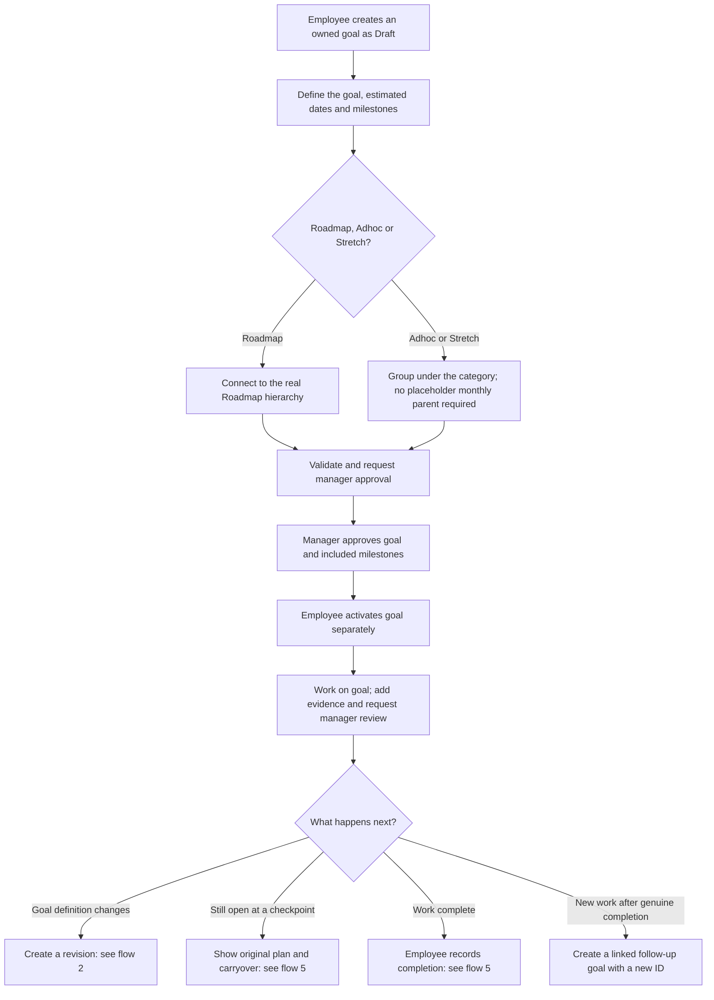
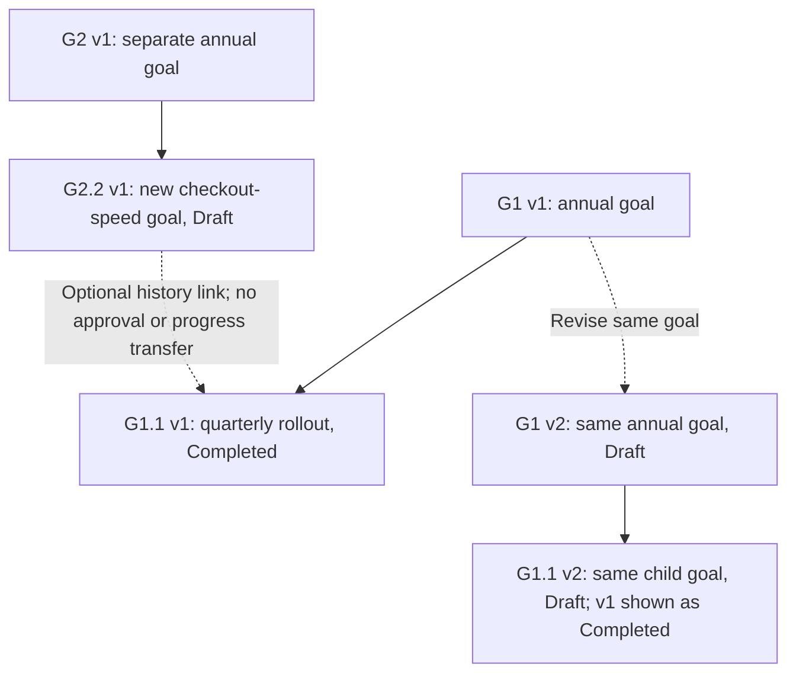
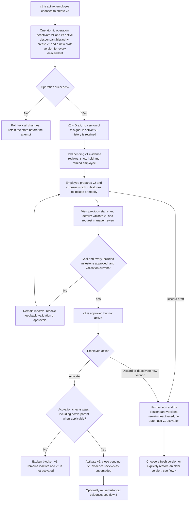
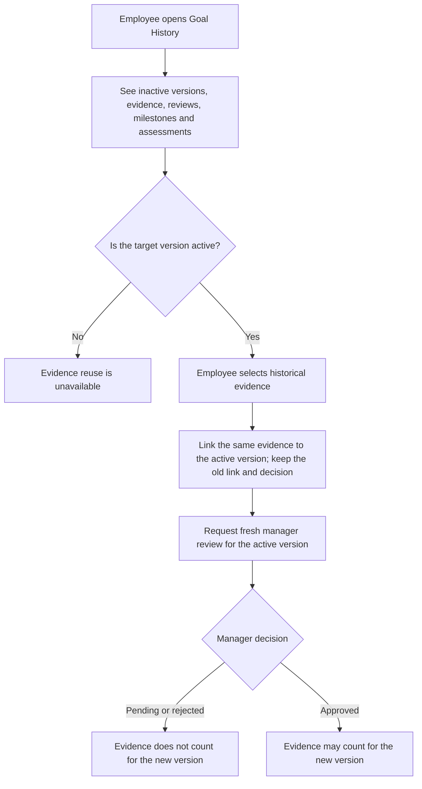
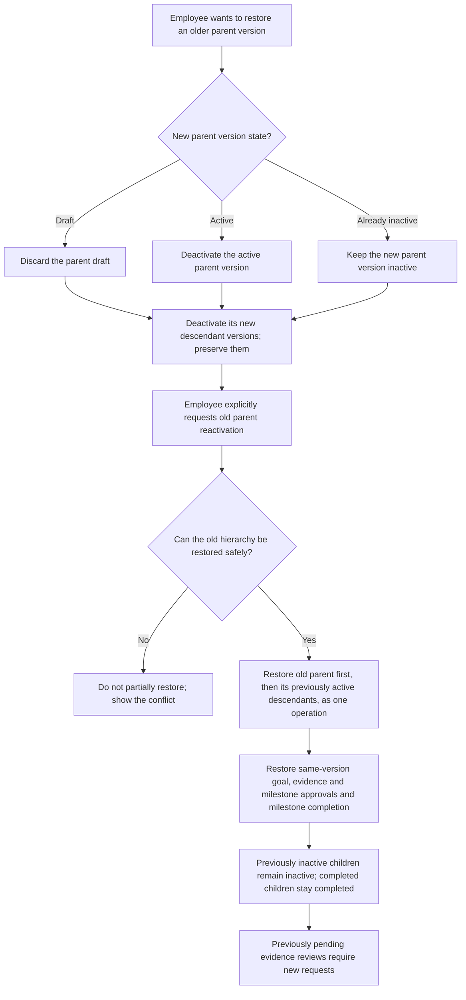
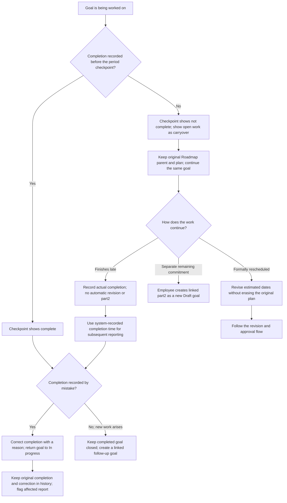

# M6.6 - Goal Versioning End-to-End Flow

**Status:** Product design draft, updated 2026-11-23. These diagrams describe the **intended flow**, not current application behavior. The new deactivation, approval, activation, evidence, and hierarchy flows are not yet implemented end to end. See [Questions and Decisions](./M6.6-Goal-Versioning-Questions-and-Decisions.md) for scenarios, safeguards, and unresolved decisions, and the [M6.6 workstream map](./M6.6-Implementation-Plan-Final-Draft.md#0-current-m66-workstream-map) for their place in the wider milestone.

**Reading the diagrams:** `v1` means the previously active version and `v2` means a new draft version of the same goal. For a goal with existing revisions, the next version number may be greater than 2. A version can be inactive while its history remains available.

## 1. Overall goal journey

Roadmap follows Annual > Quarterly > Monthly > Sprint. A child with a real parent can only be activated when its immediate parent is active. Adhoc and Stretch are categories; unparented work does not need artificial monthly goals. A sprint crossing month-end is not automatically a scheduling conflict.

### Example: same parent revised or a new parent created

`G1 v2` is a new version of G1; `G2` is a different goal. New work can be created directly as G2.2 under G2, without first creating G1.2. These IDs are illustrative, not a database naming requirement. G1.1 v1 remains Completed. Its v2 draft may be activated after the required goal and milestone approvals and when G1 v2 is active; v2 does not inherit the old completion or progress. Creating G2 does not by itself deactivate G1.

## 2. Revise an active goal

- Every included v2 milestone requires fresh manager approval, even when copied unchanged. Changing an approved milestone requires approval again. Milestone completion and progress do not automatically carry over.
- The manager may review v2 goal and milestone approvals while v1 evidence reviews are held. Holding v1 evidence reviews must not block v2's review.
- For a parent revision, descendant drafts are created even for completed or already inactive descendants. Their prior status and details are visible as context. Following required approvals, the employee can activate the new draft when its parent is active, without inheriting completion or progress. Old completed versions remain completed.
- Each new child draft starts from that child's latest goal version, even if inactive or unapproved. Record and display the source; the employee can modify the draft before review. Creating the hierarchy must recheck the sources atomically so concurrent changes are not silently missed.
- Descendant versions are approved and activated separately, parent-first. A manager can approve several goals before the employee activates them one by one.
- A manager may select previously approved parent and child versions **and unchanged milestones** for grouped fresh approval. Changed goals or milestones require individual review. The grouped action rechecks eligibility, records a fresh decision for each selected item, and succeeds or fails together; it does not activate goals.
- A failed activation does not undo the earlier successful v1 deactivation. A failed **creation** operation, by contrast, rolls back to the state before creation.

## 3. Evidence and Goal History

Old assessments and approvals remain with their original version; the new version starts not yet assessed. Reuse does not duplicate evidence or inherit the old approval.

When v1 becomes inactive, pending v1 evidence reviews are held. The server checks again when a manager submits a decision, even if the review page was opened earlier. Activating v2 closes those v1 requests as **superseded**, not rejected. Reactivating v1 preserves its previously approved evidence, but previously pending reviews need new requests.

## 4. Deactivate the new hierarchy and restore the old one

The employee does not need to discard each automatically created child draft individually. At most one version of a goal can be active. A child cannot be activated or reactivated while its immediate parent is inactive.

**Open:** The exact conflict-resolution procedure if descendants were independently changed or now have conflicting versions; restoration must not silently overwrite changes.

## 5. Dates, carryover, completion, and correction

- Estimated dates describe the plan; actual dates describe execution. A manually entered earlier actual end date does not backdate the system-recorded completion used for checkpoints.
- Month-end and calendar quarter-end are reporting checkpoints by default, not automatic hard deadlines. A May goal marked complete June 12 missed May but was complete by Q2 end; a goal marked complete July 2 was not complete at Q2 end.
- A December 2026 goal completed in January 2027 remains under its original 2026 Roadmap, is shown as carryover, and does not automatically count toward a 2027 annual goal.
- A corrected completion remains visible as originally reported, with a correction flag. Count the goal only once toward its original annual outcome.
- The employee decides all four dates for the new version. Show each corresponding previous-version date below its field as reference; do not change the previous version. Entering an actual end date does not complete v2: the employee must separately select **Mark complete** for v2. Date-field defaults are **open**.

## 6. Open decisions before implementation of affected cases

- Where is the boundary between a revised draft of a completed descendant and materially different work that requires a new goal ID?
- Should new version date fields start blank or be prefilled?
- How should the latest product-visible child version be identified when legacy snapshots or technical observation records are present?
- How should independent child changes or conflicting versions be resolved before group restoration?
- What happens to goal and milestone approvals if the goal definition itself changes after manager approval?
- How are evidence content changes bound to the manager decision that reviewed the original content?
- What reporting time zone, reminder schedule, hard-deadline workflow, and checkpoint representation for inactive versions should apply?

See the [scenario catalogue](./M6.6-Goal-Versioning-Questions-and-Decisions.md#9-scenario-catalogue) for happy paths, edge cases, and negative cases.
